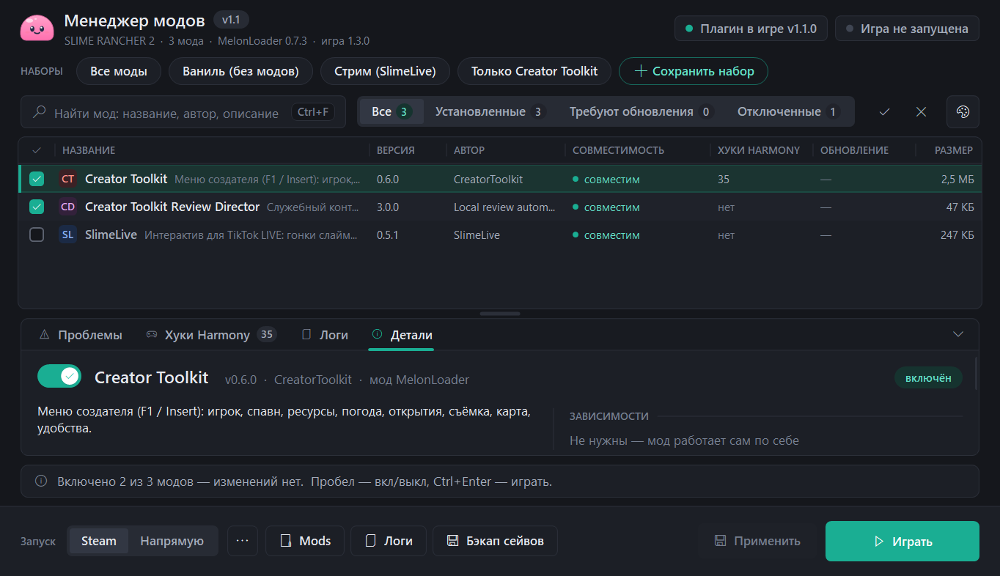
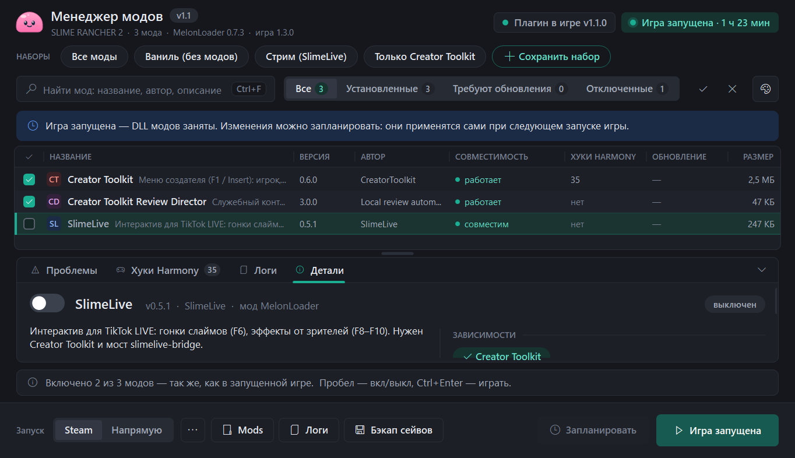
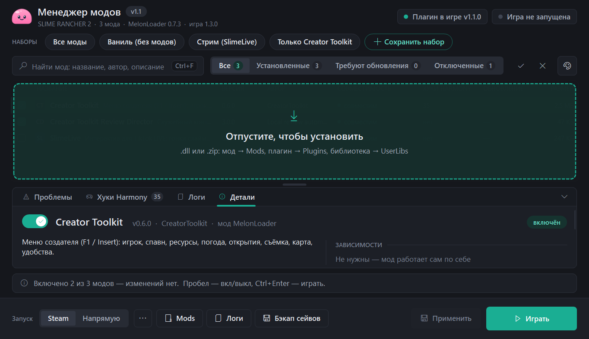
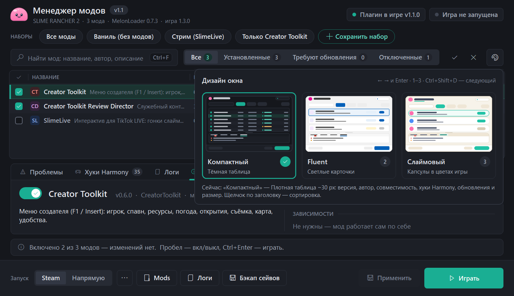
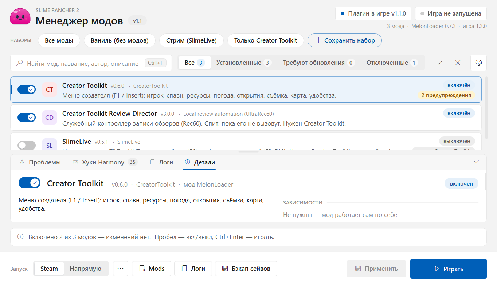
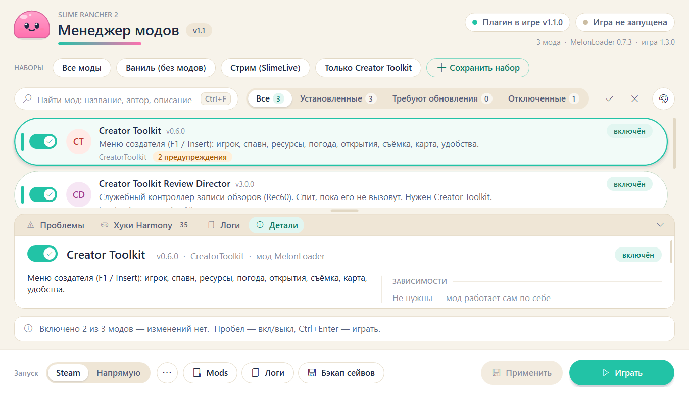
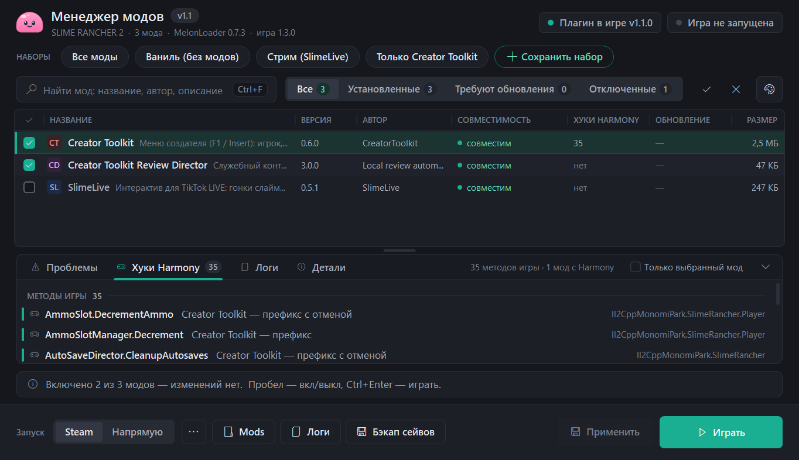

# SR2 Mod Manager

Менеджер модов для **Slime Rancher 2** на MelonLoader. Это окно, которое открывается перед запуском игры: в нём моды включаются и выключаются одним кликом, собираются в наборы и проверяются на совместимость и конфликты. Ещё есть небольшая панель прямо в игре (F5).

*Mod manager for Slime Rancher 2 (MelonLoader, Il2Cpp): toggle mods, presets, compatibility and Harmony conflict checks, save backups, in-game panel. The UI is in Russian.*



## Содержание

- [Возможности](#возможности)
- [Требования](#требования)
- [Установка](#установка)
- [Как пользоваться](#как-пользоваться)
- [Дизайн окна и нижняя панель](#дизайн-окна-и-нижняя-панель)
- [Горячие клавиши](#горячие-клавиши)
- [Проверка совместимости](#проверка-совместимости)
- [Где что лежит](#где-что-лежит)
- [Командная строка](#командная-строка)
- [Сборка и тесты](#сборка-и-тесты)
- [Производительность](#производительность)
- [Структура проекта](#структура-проекта)
- [Удаление](#удаление)
- [Лицензия](#лицензия)

## Возможности

**Моды и наборы**

- Список всех модов из `Mods` с переключателями. Выключенный мод никуда не пропадает: файл переезжает в `Mods\Disabled`, а при включении возвращается обратно.
- Наборы: «Все моды», «Ваниль (без модов)» и свои. Переключаются одним кликом. Набор можно экспортировать и импортировать в JSON или zip вместе с DLL (с проверкой SHA-256). Правой кнопкой набор можно переименовать или перезаписать, а ещё сделать для него ярлык на рабочем столе.
- Зависимости. Когда вы включаете мод, нужные ему моды включаются сами. Перед запуском менеджер проверяет, что ничего не забыто.
- Поиск по названию, автору и описанию и фильтры: все, установленные, требуют обновления, отключённые, проблемы.
- Установка перетаскиванием: бросьте `.dll` или `.zip` в окно или на exe. Мод попадёт в `Mods`, плагин — в `Plugins`, библиотека — в `UserLibs`.
- Каталог и обновления без интернета. Доступные моды и их новые версии ищутся в `ModManager\Library`, в «Загрузках» (файлы за 60 дней) и в своих папках. Прошлые версии сохраняются, любую можно вернуть.

**Проверки**

- Совместимость каждой DLL с установленными MelonLoader, Unity и версией игры. Игру для этого запускать не нужно ([подробнее](#проверка-совместимости)).
- Конфликты хуков Harmony: какие моды патчат одни и те же методы игры и чем это грозит.
- Журнал прошлого запуска: ошибки и предупреждения из `MelonLoader\Latest.log` видны прямо у того мода, к которому они относятся.

**Запуск и игра**

- Запуск через Steam или напрямую через `SlimeRancher2.exe`.
- Если игра уже запущена, файлы модов заняты. Тогда изменения можно «запланировать»: плагин применит их при следующем запуске, ещё до загрузки модов.
- Панель в игре (F5): какие моды работают сейчас и что изменится после перезапуска, переключение модов и наборов, ошибки из журнала, перезапуск игры с новым набором.

**Сохранения**

- Бэкап сейвов в один клик. Получается zip с `manifest.json`, где записан SHA-256 каждого файла. Сразу после записи архив проверяется.
- Безопасное восстановление. Сначала архив распаковывается и сверяется во временной папке. Потом текущие сейвы уходят в страховочный бэкап, и только после этого их заменяют. В конце результат ещё раз сверяется по SHA-256, а если какой-то файл занят, всё откатывается назад.
- Перед обновлением модов сейвы сохраняются в бэкап автоматически.

**Удобство**

- Три дизайна окна: «Компактный» (тёмная таблица, по умолчанию), «Fluent» (карточки) и «Слаймовый» (капсулы в цветах игры). Переключаются на лету, без перезапуска ([подробнее](#дизайн-окна-и-нижняя-панель)).
- Нижняя панель с вкладками «Проблемы», «Хуки Harmony», «Логи» и «Детали»: все проблемы, конфликты хуков и журнал игры под рукой, не уходя из списка.
- Всё делается с клавиатуры ([горячие клавиши](#горячие-клавиши)). Быстрые кнопки: папка Mods, логи, бэкап сейвов.
- Большие списки не тормозят: прокрутка виртуальная, карточки кэшируются. 500+ модов прокручиваются без рывков ([замеры](#производительность)).
- Поддерживается высокий DPI.

## Требования

- Windows 10 или 11 (x64).
- Slime Rancher 2 (Steam) с **MelonLoader 0.6 или 0.7**. Проверено на MelonLoader 0.7.3 Open-Beta, игре 1.3.0 и Unity 6000.0.73f1.
- **.NET 8 Desktop Runtime** (x64) для лаунчера. Для сборки из исходников нужен **.NET 8 SDK**.

## Установка

1. Установите MelonLoader в папку игры и запустите игру один раз. MelonLoader сгенерирует сборки в `MelonLoader\Il2CppAssemblies` — без них плагин не соберётся.
2. Соберите и установите менеджер:

```powershell
git clone https://github.com/sergltvn-rgb/SR2ModManager.git
cd SR2ModManager
powershell -ExecutionPolicy Bypass -File build.ps1 -Install
```

Скрипт сам найдёт папку игры в библиотеках Steam, соберёт плагин и лаунчер и установит:

- `<игра>\Plugins\SR2ModManager.dll` — плагин MelonLoader;
- `<игра>\ModManager\SR2ModLauncher.exe` — лаунчер, рядом `uninstall.ps1`;
- ярлык «SR2 Mod Manager» на рабочем столе.

Если игра установлена не в Steam-библиотеку, укажите папку: `-GameDir "E:\Games\Slime Rancher 2"`. Если `dotnet` нет в PATH, передайте путь через `-Dotnet "C:\...\dotnet.exe"` или положите SDK в папку `.dotnet` рядом со скриптом. Ставить можно и при запущенной игре: новый плагин подхватится при следующем запуске.

## Как пользоваться

1. Откройте «SR2 Mod Manager» с рабочего стола (или `ModManager\SR2ModLauncher.exe`).
2. Включите нужные моды или выберите набор. Подробности выбранного мода — на вкладке «Детали» нижней панели (двойной щелчок по моду сразу открывает её): совместимость, зависимости, каким модам он нужен, журнал прошлого запуска, файл и старые версии.
3. Нажмите «Играть» (`Ctrl+Enter`) — изменения применятся, и игра запустится. Кнопка «Применить» (`Ctrl+S`) сохраняет изменения без запуска.
4. В игре нажмите F5, чтобы открыть панель модов. Клавишу можно поменять в `UserData\MelonPreferences.cfg`: раздел `[SR2ModManager]`, параметр `Hotkey`.

Если игра уже запущена, вместо «Применить» появится «Запланировать»:



Новый мод можно просто перетащить в окно:



## Дизайн окна и нижняя панель

Кнопка «Дизайн» на панели инструментов (или `Ctrl+Shift+D`, или меню «Ещё» → «Дизайн окна…») переключает оформление. Палитра, список и панели перерисовываются сразу, перезапуск не нужен:

| Дизайн | Как выглядит |
|---|---|
| **Компактный** (по умолчанию) | тёмная таблица со строками ~30 px: флажок, значок и название, версия, автор, совместимость, хуки Harmony, обновление, размер. Щелчок по заголовку колонки сортирует, второй — в обратном порядке, третий — возвращает исходный порядок |
| **Fluent** | светлые карточки ~58 px с описанием и метками |
| **Слаймовый** | капсулы в цветах игры, с мягкими тенями |



| Fluent | Слаймовый |
|---|---|
|  |  |

Внизу окна — панель с вкладками:

- **Проблемы** — ошибки и предупреждения: окружение, зависимости, конфликты, совместимость, ошибки в журнале;
- **Хуки Harmony** — какие методы игры патчат включённые моды и где они пересекаются (переключатель «Только выбранный мод»);
- **Логи** — хвост `MelonLoader\Latest.log`, обновляется на лету; переключатели «Только ошибки» и «Только выбранный мод»;
- **Детали** — подробности выбранного мода.

Щелчок по строке на вкладках выбирает её мод в списке, двойной щелчок или `Enter` — открывает его «Детали».



Высоту панели меняет полоска над ней (перетащить мышью; двойной щелчок по полоске или `Ctrl+J` сворачивает и разворачивает панель), `Ctrl+1`…`Ctrl+4` открывают вкладки. Дизайн, сортировка, вкладка, высота панели и фильтры запоминаются в `UserData\ModManager\ui.json`:

```json
{
  "design": "compact",
  "sort": "compat",
  "sortDesc": true,
  "dockTab": "details",
  "dockHeight": 260,
  "dockCollapsed": false,
  "logErrorsOnly": false,
  "logSelectedOnly": false,
  "hooksSelectedOnly": false
}
```

`design` — `compact`, `fluent` или `slime`; `sort` — `check`, `name`, `version`, `author`, `compat`, `hooks`, `update`, `size` или пусто (без сортировки); `dockTab` — `problems`, `hooks`, `logs` или `details`; `dockHeight` — высота панели в пикселях при 100 % масштаба (0 — по умолчанию). Если файла нет или он испорчен, берутся значения по умолчанию.

## Горячие клавиши

| Клавиши | Действие |
|---|---|
| `Пробел` / `Enter` | включить или выключить выбранный мод |
| `↑` `↓` | выбрать мод |
| `Ctrl+F` или `/` | поиск (можно просто начать печатать; `Esc` — очистить) |
| `Ctrl+S` | применить |
| `Ctrl+Enter` | применить и играть |
| `Ctrl+O` | установить мод из файла |
| `F5` | обновить список |
| `Del` | удалить мод в корзину |
| двойной щелчок по моду | открыть вкладку «Детали» |
| `Ctrl+Shift+D` | следующий дизайн окна |
| `Ctrl+J` | свернуть или развернуть нижнюю панель |
| `Ctrl+1` … `Ctrl+4` | вкладки панели: «Проблемы», «Хуки Harmony», «Логи», «Детали» |
| `F5` в игре | панель модов |

## Проверка совместимости

Менеджер читает метаданные и IL-код DLL через `System.Reflection.Metadata`. Моды при этом не загружаются в процесс и не выполняются. Что проверяется:

- атрибуты MelonLoader: `MelonInfo`, `MelonGame`, `MelonGameVersion`, `VerifyLoaderVersion`, `MelonAdditionalDependencies`, `MelonOptionalDependencies`, `MelonIncompatibleAssemblies`, `MelonPriority`, `HarmonyDontPatchAll`, а также `TargetFramework`;
- под какие версии собран мод (MelonLoader, .NET, Il2CppInterop, Harmony, Tomlet) и подходят ли они к установленным;
- мод для другой игры, для Mono-версии или для MelonLoader 0.5 (Unhollower), дубликаты, нехватка библиотек и других модов;
- не устарели ли сборки Il2Cpp: бывает, что игра обновилась, а MelonLoader ещё не перегенерировал сборки. Это определяется по SHA-512 `GameAssembly.dll`;
- синтаксис `UserData\MelonPreferences.cfg` (TOML);
- конфликты хуков Harmony: по атрибутам `[HarmonyPatch]` и по вызовам `harmony.Patch(...)` в коде.

Каждая проблема объясняется простыми словами, и к ней есть подсказка, что делать.

## Где что лежит

Все пути — относительно папки игры.

| Путь | Что это |
|---|---|
| `Mods\` | включённые моды |
| `Mods\Disabled\` | выключенные моды |
| `Mods\Disabled\_replaced\` | прошлые версии модов после обновления |
| `Plugins\SR2ModManager.dll` | плагин: применяет запланированные изменения до загрузки модов, панель F5 |
| `ModManager\SR2ModLauncher.exe` | лаунчер |
| `ModManager\Library\` | ваша библиотека модов (каталог и обновления) |
| `UserData\ModManager\profiles.json` | наборы, описания, дополнительные зависимости, свои папки каталога (`catalogFolders`), `scanDownloads`, настройки окна |
| `UserData\ModManager\ui.json` | дизайн окна, сортировка таблицы, нижняя панель ([подробнее](#дизайн-окна-и-нижняя-панель)) |
| `UserData\ModManager\pending.json` | изменения, запланированные на следующий запуск |
| `UserData\ModManager\modmanager.log` | журнал действий менеджера |
| `UserData\ModManager\Backups\Saves\` | бэкапы сохранений (zip с `manifest.json`) |

## Командная строка

```text
SR2ModLauncher.exe                                 окно выбора модов
SR2ModLauncher.exe --game "<папка игры>"           явно указать папку игры
SR2ModLauncher.exe --profile "<набор>" --launch    применить набор и сразу запустить игру, без окна
SR2ModLauncher.exe --install <файлы .dll/.zip>     установить моды и открыть окно
```

Для разработки есть ещё два ключа: `--render <png>` рисует окно в PNG и ничего не меняет на диске (так сделаны скриншоты в этом README), а `--bench <json>` замеряет запуск, прокрутку и переключение модов. Для них `ui.json` не читается, а вид окна задаётся ключами:

```text
--design compact|fluent|slime          дизайн (для --render и --bench)
--dock problems|hooks|logs|details     вкладка нижней панели; --dock-collapsed — панель свёрнута (только --render)
--sort <колонка>[:asc|:desc]           сортировка таблицы, например --sort compat:desc (только --render)
--picker                               открыть окно выбора дизайна (только --render)
--switch-design <дизайн>               после показа окна сменить дизайн на лету (только --render)
```

## Сборка и тесты

```powershell
.\build.ps1           # собрать в .\_build
.\build.ps1 -Test     # собрать и прогнать тесты
```

Тесты работают на временных копиях, поэтому папка игры и сейвы не меняются. С установленной игрой выполняется 217 проверок: переключение модов и наборы, зависимости, запланированные изменения, каталог и версии, совместимость на настоящих DLL, конфликты Harmony, экспорт и импорт наборов, бэкапы и восстановление сейвов, а также `ui.json`, сортировка таблицы и разбор журнала для вкладки «Логи». Если папки игры нет, собирается только лаунчер, а проверки на настоящих модах пропускаются.

Плагин можно собрать и вручную:

```powershell
dotnet build Plugin\ModManagerPlugin.csproj -c Release -p:GameDir="E:\Games\Slime Rancher 2"
```

## Производительность

Замеры через `--bench`: 504 мода в списке, экран 60 Гц.

| | Было | Сейчас (1.1) |
|---|---|---|
| Первый кадр окна | 505 мс | 490 мс |
| Кадр прокрутки, медиана | 18,9 мс | 3,2 мс |
| Кадр прокрутки, p95 | 24,7 мс | 4,7 мс |
| Кадров дольше 16,7 мс (из 120) | 111 | 0 |
| Прокрутка колесом | 12 рывков по 82 px | плавно, ~76 кадров по 12 px |
| Вкл/выкл выбранного мода | 47,6 мс | 24,6 мс |
| Вкл/выкл другого мода | 51,2 мс | 8,3 мс |
| Память после запуска | 33 МБ | 45 МБ |

Памяти теперь нужно больше, в основном из-за новой проверки совместимости и кэша карточек.

Прокрутка в разных дизайнах (503 мода, масштаб 125 %, 120 кадров, игра запущена в фоне):

| | Компактный | Fluent | Слаймовый |
|---|---|---|---|
| Кадр прокрутки, медиана | 6,0 мс | 4,7 мс | 3,6 мс |
| Кадр прокрутки, p95 | 8,3 мс | 6,5 мс | 5,7 мс |
| Кадров дольше 16,7 мс (из 120) | 1 | 0 | 0 |

В компактном дизайне за кадр рисуется больше строк, поэтому он немного дороже остальных.

## Структура проекта

```text
Launcher/       лаунчер (WinForms, .NET 8): главное окно, виртуальный список модов, панель подробностей,
                свои контролы и тема (рисуются через GDI+), значки модов, замеры (--bench)
  Designs.cs    три дизайна: палитры и размеры; DesignPicker.cs — окно выбора дизайна
  Dock.cs       нижняя панель: вкладки «Проблемы», «Хуки Harmony», «Логи», «Детали»
Shared/         общий код
  ModCore.cs    моды, наборы, зависимости, запланированные изменения, запуск игры (его использует и плагин)
  Catalog.cs    каталог, версии, обновления, установка из файлов
  Compat.cs     проверка совместимости, IL-сканер, конфликты Harmony
  Backups.cs    бэкапы и восстановление сохранений
  UiPrefs.cs    ui.json: дизайн, сортировка, нижняя панель; порядок сортировки и разбор журнала (для тестов)
Plugin/         плагин MelonLoader (net6.0): применяет pending.json до загрузки модов, панель F5
Tests/          консольные тесты: dotnet ModManager.Tests.dll [<папка Mods>]
build.ps1       сборка, тесты, установка
uninstall.ps1   удаление
```

## Удаление

```powershell
# удалить менеджер, моды не трогать
powershell -ExecutionPolicy Bypass -File "<игра>\ModManager\uninstall.ps1"
# удалить и вернуть все выключенные моды в Mods
powershell -ExecutionPolicy Bypass -File "<игра>\ModManager\uninstall.ps1" -EnableAll
```

Удаляются плагин, лаунчер, ярлык и запланированные изменения. Наборы и бэкапы сохранений остаются в `UserData\ModManager`.

## Лицензия

[MIT](LICENSE) © 2026 sergltvn-rgb

Проект не связан с Monomi Park. Slime Rancher — товарный знак Monomi Park.
